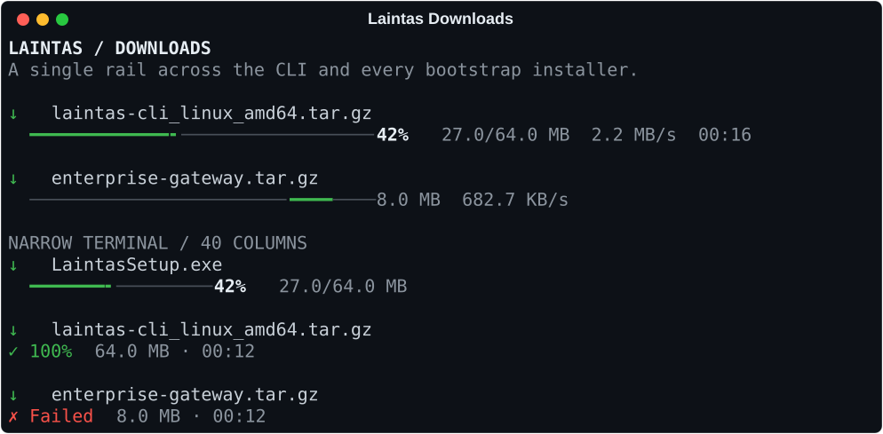

# Unified download progress



CLI updates, Enterprise extensions and gateway bundles use
`download_progress.py`. The standalone Bash and PowerShell bootstraps mirror
the same layout without requiring Python or an installed Laintas runtime.

```text
  ↓ laintas-cli_linux_amd64.tar.gz
  ━━━━━━━━━━━━━╸───────────────────   42%  27.0/64.0 MB  2.3 MB/s  00:16
```

The file label sits above a single moving row. Received bytes use green
(`#3fb950`), the remaining rail uses `#484f58`, and transfer metrics use
`#8b949e`. The percentage uses bold `#e6edf3`; the filename uses `#c9d1d9`.
Refreshes are limited to roughly 150 ms. A short segment travels along the rail
when the total is unknown; only the received bytes and speed are shown,
without a percentage or ETA. Windows consoles with virtual terminal support
use the same RGB colors; older consoles use native console colors.
`NO_COLOR` disables color.

The meter leaves the filename and one persistent result:

```text
  ✓ 100%  64.0 MB · 00:28
  ✗ Failed  8.0 MB · 00:12
  ○ Cancelled  8.0 MB · 00:12
```

Completion means the transfer finished, including its byte count check when
the length is available. Checksum verification and installation remain later
steps with their existing checks. A stopped or incomplete transfer must never
display a successful result.

Narrow terminals omit ETA first and speed second. All repaint rows reserve
the final terminal cell to prevent wrapping. Labels are truncated when needed;
Python measures terminal cells so wide characters remain within the row.
Redirected output contains only the filename and result, without cursor
controls. `NO_COLOR` disables color while preserving in-place animation on a
terminal. `TERM=dumb` disables animation.

The Python meter reuses the foreground append-input Live when present. With a
prompt-toolkit/mirror output proxy it paints directly to the TTY, clearing each
row before repainting. Every path closes the response and stops its refresh
worker; failures and interrupts also close the TTY descriptor. The Bash
bootstrap owns its curl child and temporary files and removes them on exit.
PowerShell disposes its HTTP client, response and streams in `finally`.
Its [headers-first HTTP request](https://learn.microsoft.com/en-us/dotnet/api/system.net.http.httpcompletionoption?view=netframework-4.8.1)
also uses a separate cancellation token for the streamed body.

Validation:

```bash
PYTHONDONTWRITEBYTECODE=1 venv/bin/python -m pytest -q -p no:cacheprovider \
  tests/test_download_progress.py tests/test_restart_update.py \
  tests/test_mac_beta.py tests/test_build_release_assets.py

# Optional PowerShell bootstrap coverage alongside Bash integration tests:
LAINTAS_TEST_PWSH=/path/to/pwsh PYTHONDONTWRITEBYTECODE=1 \
  venv/bin/python -m pytest -q -p no:cacheprovider \
  tests/test_installer_download_progress.py
```

Bootstrap tests stream from a local HTTP server, render into a PTY, and never
invoke the installation wizard or replace an installed CLI. They cover fixed
and unknown HTTP lengths, redirects, failures, narrow terminals, no-color and
redirected output. Real macOS Bash 3.2 and Windows PowerShell 5.1 smoke tests
remain platform checks before release.
